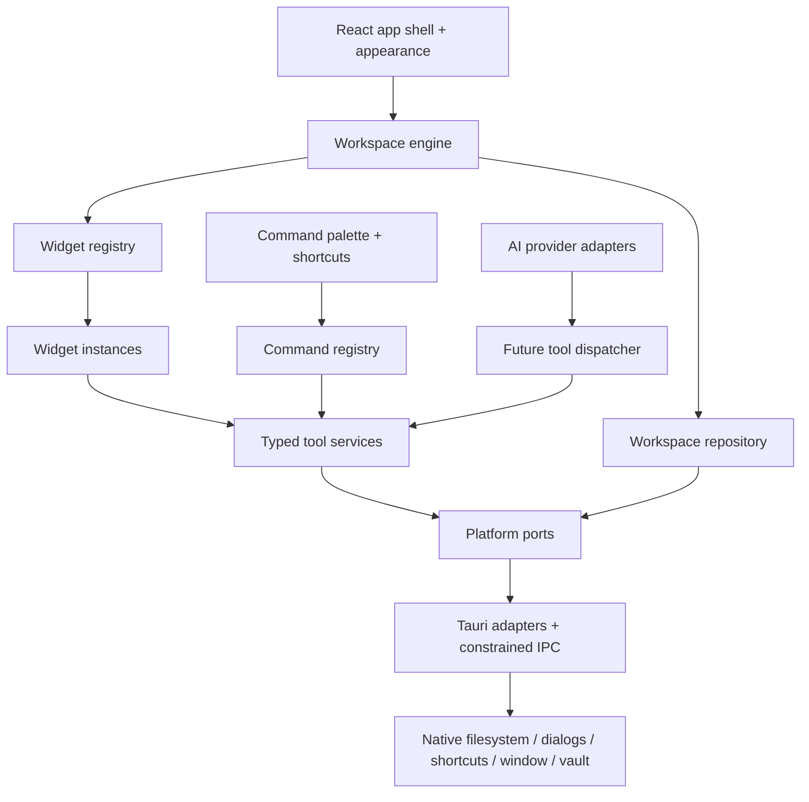

# Real Chrome overlay — current decisions

ver0.18 adds a searchable Apps tray picker for open desktop windows, with executable metadata names, icons, explicit previews, Attached badges and exact HWND/PID validation. Selected identities are transient; saved widgets/presets retain only opaque native app grants. Saved-app clicks reuse one matching available window, refuse ambiguous document choices, or launch if no match exists. Previews use separate workers, bounded waiting and a limit of two outstanding renders. The ver0.17 native app geometry/ownership/clipping/release system remains, without SetParent. The web preview and automated fixtures passed; real third-party desktop acceptance remains pending. See still-desktop/docs/plans/2026-10-05-open-app-picker.md. Earlier notes below are historical.

ver0.17 replaces the Apps external launcher with an owned top-level native window positioned and clipped over each Apps card. It never uses SetParent. App launches resolve ordinary shortcuts, select a new matching window, and keep a pending ticket for retry without duplicate launches. Attach open window provides explicit selection for existing/single-instance apps. Native events synchronize geometry, workspace visibility, focus and minimization; initial minimum dimensions can grow the card. Detach/removal/Still close restore original ownership, region and placement without closing documents. Saved open intent, screenshot composition and focus-aware hotkeys are included. Existing tray, files, Groups and Chrome behavior remain; Word interactive acceptance is still required. See still-desktop/docs/plans/2026-10-05-managed-app-panels.md. Earlier notes below are historical.

ver0.16 adds typed document and Apps shortcuts, external native file drops, green matching-button save targets and red empty-tray instance removal. Saved presets preserve useful widget state and create independent instances through pointer tray dragging. Native document/app grants persist exact paths behind opaque IDs; PDFs open in their default viewer and apps launch outside Still only on explicit Launch app. Existing Groups, Chrome overlay and hotkeys are retained. See still-desktop/docs/plans/2026-10-05-drop-shortcuts.md and archive/older-versions/ver0.16-drop-tray.png for design and preview evidence.

ver0.15 adds global custom Browser and Files presets under disclosure arrows on their existing tray buttons. Browser presets remember a name and starting HTTPS URL; Files presets reuse a previously selected native folder through opaque IDs and preserve each instance's own folder changes. Existing per-workspace Groups, browser overlay and native shortcuts are retained.

ver0.14 adds per-workspace saved group libraries and expandable named buttons in the tray. Course links and widget type entries add fresh instances by click or drag; closing a Group card keeps its collection. GroupEditor is shared by cards and tray editing. Original browser and native shortcut implementation files are preserved from ver0.13.

ver0.13 restores the original Still-Chrome browser lifecycle, positioning, exact-fit checks and visibility rules. Groups, the saved workspace model, appearance, sidebar, shortcut code and removed duplicate bookmarks are preserved from ver0.12. This supersedes ver0.12 browser overlap/overflow behavior.

ver0.12 restores the Still-Chrome footer and corner resizing, removes duplicate bookmark UI, adds saved Groups that create distinct Browser widgets, and scopes Chrome recovery to each Still owner. Overlaps and native minimum-size overflow stay visible.

Chrome visibility accepts overlaps, off-canvas regions and native minimum dimensions. Sidebar collapse is saved and shifts the native browser through existing bounds observers.

The latest release uses an owned top-level Chrome window positioned over the existing Browser panel, with a dedicated Chrome profile. SetParent is not used. Chrome supplies tabs, bookmarks and extensions. Event-driven native positioning, focus-filtered workspace hotkeys including Shift, retained visited canvases, saved shortcuts and 80% Lecture mode are implemented. Earlier browser decisions below are historical. See still-desktop/docs/plans/2026-10-04-chrome-overlay.md for checks and remaining interactive acceptance.

---

# Browser and bookmarks release — current decisions

The latest release restores the native WebView2 Browser widget inside the free canvas, superseding the external-launcher decision below. Chrome is retained only as an optional external link destination. Each browser has saved bookmarks and a collapsible bookmark panel. Lecture mode expands the chosen widget to 80% of visible workspace width while retaining its prior geometry for restoration. State version 4 migrates existing launcher shortcuts into bookmarks once. Native widget screenshots composite the website child view into the app frame.

The existing canvas, widget tray, screenshot clipboard fallback, app-local profile, Liquid Glass, Files and configurable workspace hotkeys remain. See the source browser-bookmarks plan for validation and limitations.

---

Latest utility change (3 October 2026): free-position, independently resizable widget canvas and top widget tray are implemented, replacing the earlier grid/lecture interaction. Browser is now Web / Chrome: editable/reorderable shortcuts open the installed normal Chrome profile, with no embedded-browser commands. Multiple independent instances, saved positions/sizes/content and one-level undo are implemented. Camera click/drag uses clipboard PNG fallback; Windows captures/crops the main rendered WebView2 surface and exports through a Save dialog. A manual timetable is included; Desmos internal iframe expressions are not persisted. These decisions supersede embedded browser/lecture and future grid references below. Native Chrome/capture UI remains manual acceptance; 17 frontend and 5 Rust tests pass.

Latest change (3 October 2026): browser home/search now uses Google. Files is implemented behind native files_choose/files_list/files_open commands, limited to folder roots chosen through the OS picker and persisted per widget. Directory traversal, paths outside the chosen root, and program/shortcut launching are rejected. The web preview can browse explicitly selected local files for the current session. Earlier references to Files as a concept or future milestone are superseded. Native file launching remains unverified.

Latest implementation change: the user removed timetable scope and prioritized lecture viewing. Browser workspaces now default to a compact lecture layout with an 80% browser width, separately scrolling tools, a draggable divider and per-workspace width/height controls. Earlier timetable decisions below are historical and superseded. Native lecture playback remains unverified.

# Personal Workspace — architecture proposal

Latest appearance change (3 October 2026): Liquid Glass and Quiet minimal are selectable. The original leaf photograph is bundled locally and receives CSS desaturation and defocus. Saved blur, saturation and glass-opacity controls accompany light/dark material variants, inspired by [Apple materials](https://developer.apple.com/design/human-interface-guidelines/materials). Widget placement and utility scope are preserved; freeform resizing and PDF viewing remain future work.

Prepared 2 October 2026. Status: **architecture proposal with a compiled Windows browser-focused prototype**. Visual direction: quiet minimal, selected by the user. `design-preview.html` is the React browser preview; the Windows native build packages that UI inside Tauri.

## Confirmed follow-up requirements

The user requested custom workspaces, a scientific calculator, and an actual browser widget for Ako Learn and the timetable inside Ako Learn. They then selected **Desmos instead of a custom calculator**, and identified the browser as the priority. Rust and Microsoft C++ Build Tools installation and building the Windows app were explicitly authorized.

The implementation now uses React widget definitions and independent serializable instances. Custom workspaces support creation with chosen widgets, rename, duplication, removal with undo, and per-workspace widget order/width. Desmos scientific is an external website preset. General browser widgets accept HTTPS URLs, provide back/forward/reload, expand, Ako Learn and timetable shortcuts, and a manually pinned timetable page. The default timetable shortcut opens Ako's dashboard; it does not invent a timetable URL or parse personal course data.

### ADR-006: Native browser views behind a platform adapter

**Decision:** Use Tauri native child WebViews for third-party websites, rather than framing Ako inside the app DOM. A live HTTP header check on 2 October 2026 returned `X-Frame-Options: DENY` from Ako Learn. Desmos can be framed in the web preview, while the desktop browser adapter treats it as an external native view.

**Trade-off:** Tauri 2.12.1 is a stable package, but creating multiple child WebViews in one window still requires its **experimental `unstable` Cargo feature**. Keep that dependency inside `src-tauri/src/browser.rs` and the frontend `platform/browser.ts` port. The stable separate-window alternative would not meet the user's browser-within-a-widget requirement.

Only the local `main` WebView has browser-control capabilities. Native commands also verify the calling view and its local URL. Remote guest views and sign-in popups have no native capabilities, filesystem bridge, arbitrary command evaluator, or access to app notes. Browser navigation validates HTTPS addresses and rejects embedded credentials and active/local schemes. Back/forward/reload use fixed native navigation instructions.

University browser instances use a shared persistent app-owned profile on Windows. The macOS adapter uses a fixed WebKit data-store identifier, requiring macOS 14 or later for that profile strategy. Do not import Chrome's cookies or the user's saved passwords; the user signs in directly. Sign-in popup windows preserve the relationship required by SSO, but institutional SSO and macOS behavior need actual platform verification.

Native views follow their widget's logical pixel bounds and hide when another workspace or a modal covers them. A browser can expand to the full workspace width. It currently hides when partly outside the viewport, so scroll it fully into view; clipping behavior is a follow-up refinement.

This first native prototype persists workspace data in the app WebView's localStorage. The versioned JSON repository and durable-write design below remain the production target, not an already implemented feature. Website sessions are stored by the native WebView profile, separately from workspace data. Browsing and Desmos require internet; notes, appearance and custom workspace configuration are local.

**References:** [Tauri child WebViews](https://v2.tauri.app/reference/javascript/api/namespacewebview/), [native child-view positioning](https://docs.rs/tauri/latest/tauri/window/struct.Window.html), [Desmos scientific](https://www.desmos.com/scientific), [UC Ako Learn](https://www.canterbury.ac.nz/life/it-logins-and-tools/learn).

## Scope and source boundary

Build a local-first Windows desktop workspace using Tauri, React and TypeScript. Keep platform differences isolated so macOS can reuse the UI, workspace model and tools. No account or cloud service is needed to use local tools.

The supplied brief ends at `interface AIProvider { sendMessage`. Its requirements after that point are unavailable. Only the AI widget is explicitly specified under the V1 widget section. Notes, calculator, focus timer and file launcher below are a **proposed initial set**, inferred from earlier workspace examples, not a recovered continuation of the brief. The preview illustrates them to make the design reviewable.

## Recommended shape

A modular monolith: one desktop application, one frontend composition root, small native adapters. Tools own operations; widgets present those tools; commands expose the same operations through keyboard navigation. AI can eventually request those operations through a permission-controlled dispatcher.



The future dispatcher is an extension point, not part of the first milestone. Widgets receive services through context; they must not import Tauri APIs directly. Composition roots select real desktop adapters or test doubles.

## Alternatives and decisions

All ADRs below are proposed; they become accepted after review.

### ADR-001: One app with feature modules

**Context:** Personal use, Windows first, eventual macOS and possible public distribution.

**Decision:** Use a single Tauri app with React feature modules. Keep pure TypeScript models and domain operations independent of platform code.

**Trade-off:** Simple packaging and debugging, but import boundaries need lint enforcement. Third-party plugin isolation is not provided by ordinary React components.

**Alternatives:** An Electron app has a different runtime cost and contradicts the preferred stack. Separate native apps duplicate UI work. A web application cannot supply the requested desktop behavior on its own. A multi-process plugin host is unnecessary before third-party extensions exist.

### ADR-002: Separate definitions, instances and content

**Context:** Multiple widgets of one type must coexist without sharing unrelated state.

**Decision:** A static registry holds component definitions. Workspaces store serializable instances. Notes and conversations live in content repositories, referenced by ID.

**Trade-off:** Slightly more indirection; much easier independent state, migrations and reuse. Do not serialize components or functions.

**Alternatives:** Hard-coded homepage widgets prevent composition. Storing note text in layout objects couples editing to layout saves.

### ADR-003: Grid placement behind a layout adapter

**Context:** Position, size and spacing must be editable and restored per workspace.

**Decision:** Store canonical placement in 12-column grid units. Use a replaceable grid interaction adapter for drag/resize; shortlist libraries during the scaffold compatibility check. Normalize collisions, bounds and widget minima in the workspace engine. Small windows reflow the display without overwriting the canonical desktop layout.

**Trade-off:** Less freeform than a canvas; easier alignment, keyboard movement and predictable resizing. A library's internal layout object must not become the persistent domain schema.

**Alternatives:** Absolute pixel placement creates DPI and window-size problems. A full infinite canvas adds considerable interaction complexity.

### ADR-004: Versioned local documents, separate secrets

**Context:** Small personal datasets, no sync, layouts must survive restart.

**Decision:** A repository port stores versioned JSON documents under the OS-provided app-data directory. A small Rust filesystem adapter performs staged writes and recoverable replacement with backup, serialized through one writer. Keep independent files for layouts, preferences, notes and conversations. Never acknowledge a save before durable completion.

**Trade-off:** JSON is inspectable and exportable; migrations and crash recovery must be deliberate. SQLite becomes appropriate when relational queries, task history or search demand it. The official Store plugin is an option for simple preferences, but do not assume its saves provide the workspace recovery contract.

**Alternatives:** Browser localStorage is the current preview and native prototype implementation; migrate it to the durable repository before production use. SQLite adds schema and plugin setup before current needs justify it. Cloud storage conflicts with initial scope.

**Secrets:** Define a native `CredentialVault` port. Evaluate Stronghold with a user-unlocked vault or an OS credential-store adapter before implementing provider configuration. Stronghold needs an explicit unlocking/key derivation design; never hard-code the vault password. Keep API keys out of JSON, frontend persistent state, logs and exports.

### ADR-005: Provider-independent AI, native network transport

**Context:** AI must allow providers and later interact with tools.

**Decision:** TypeScript adapters normalize messages, model capabilities, streaming events and errors. A native transport handles credential retrieval and authenticated requests; it returns response data without exposing saved secrets. Explicitly separate local providers and remote providers.

**Trade-off:** Streaming IPC and cancellation need lifecycle handling. Provider adapters remain mostly frontend logic; Rust owns only the sensitive transport boundary.

**Alternatives:** Calling a single provider directly from a chat component makes switching and tool use difficult. Implementing an agent framework now exceeds the milestone.

## Suggested project layout

```text
src/
  app/                 composition, shell, routing, error boundaries
  workspace/           models, controller, placement normalization
  widgets/             definition types, registry, widget host
    ai/ notes/ desmos/ browser/ focus/ files/
  commands/            registry, palette, shortcut resolution
  tools/               operations, schemas, future dispatcher contract
  ai/                  provider registry, events, model capabilities
  storage/             repositories, validation, migrations
  platform/            ports, tauri adapters, test doubles
  appearance/          tokens, theme, density, backgrounds
src-tauri/
  src/                 boot, IPC, durable writes, credential transport
  capabilities/        explicit least-privilege window capabilities
  tauri.conf.json
tests/                 domain tests, adapter integration, app smoke tests
```

`platform/tauri` is the only frontend module allowed to import Tauri packages. Native `cfg` branches belong in native adapters, never UI components. Avoid a generic event bus until specific cross-module notifications are needed.

## Core contracts

Illustrative TypeScript contracts, not installed implementation:

```ts
type JsonValue = null | boolean | number | string | JsonValue[]
  | { [key: string]: JsonValue };
type Placement = { x: number; y: number; width: number; height: number };

interface WidgetDefinition {
  id: string; name: string; icon: string; settingsVersion: number;
  defaultSize: { width: number; height: number };
  minSize: { width: number; height: number };
  defaultSettings: Record<string, JsonValue>;
  component: React.ComponentType<WidgetProps>;
  validateSettings(value: unknown): Record<string, JsonValue>;
}
interface WidgetInstance {
  instanceId: string; widgetId: string; settingsVersion: number;
  placement: Placement; settings: Record<string, JsonValue>;
  contentRef?: string;
}
interface Workspace {
  id: string; name: string; widgets: WidgetInstance[];
  layout: { columns: 12; gap: number; rowHeight: number };
}
interface WorkspaceDocument {
  schemaVersion: number; revision: number; activeWorkspaceId: string;
  workspaces: Workspace[];
}
interface WidgetProps {
  instance: WidgetInstance;
  updateSettings(patch: Record<string, JsonValue>): void;
}
interface AIProvider {
  id: string;
  listModels(signal: AbortSignal): Promise<ModelDescriptor[]>;
  sendMessage(request: ChatRequest, signal: AbortSignal): AsyncIterable<AIEvent>;
}
type AIEvent =
  | { type: 'delta'; text: string }
  | { type: 'complete'; finishReason: string }
  | { type: 'error'; code: string; retryable: boolean };
interface ToolDefinition<I, O> {
  id: string; description: string; inputSchema: object;
  effect: 'read' | 'write' | 'external';
  execute(input: I, context: ToolContext): Promise<O>;
}
```

`ChatRequest`, `ModelDescriptor` and `ToolContext` are deliberately unspecified until the missing brief and provider requirements are clarified. Register definitions at boot. Unknown widget IDs render a recoverable placeholder and preserve their instance data. Reject duplicate definition IDs. Adding a Notes widget creates a distinct instance and, by default, a distinct note ID.

## Data flow and recovery

1. Read, validate and migrate persisted documents before rendering the active workspace. Retain originals before migration; open newer unsupported versions read-only.
2. Resolve each widget through the registry. Restore placement and referenced content independently. A widget error boundary contains component failures.
3. Workspace edits update in-memory state immediately. Debounce layout saves, serialize writes, and track dirty/saving/saved/error states. Retain dirty state and offer retry on disk failure.
4. Restore from the last valid backup only after informing the user. Do not silently discard corrupt notes or replace everything with defaults.
5. A timer stores an end timestamp and derives remaining time, so suspension does not accumulate interval drift. Calculator operations use a parser, never `eval`.
6. Abort provider streams on cancellation or widget disposal. Show offline, authentication, timeout and rate-limit errors distinctly; do not automatically replay potentially billable requests.

## Desktop and AI boundaries

Platform ports cover filesystem handles, native dialogs, notifications, shortcuts, window operations, OS information and credentials. UI asks the file adapter to choose/open a document; Rust validates paths and allowed operations. Avoid blanket shell execution.

App-focused workspace shortcuts resolve a logical `Primary+1` to Ctrl on Windows or Command on macOS. Global show/hide uses Tauri's global shortcut adapter, reports conflicts and allows reassignment. Global registration is not needed for ordinary workspace switching. Respect text input and IME composition; never steal editing shortcuts.

Explicitly configure capabilities for the main window. Custom native commands need their own permissions and argument checks; plugin capabilities alone are insufficient. Render note/chat content as escaped text or sanitized Markdown. Do not give remote content native capabilities.

Future AI tool calls pass through schema validation, an operation allowlist, file access checks and a review step for writes/external actions. The UI shows proposed task additions before committing them. File contents are data, never authority to change permissions. Do not implement autonomous orchestration in milestone one.

## Quiet minimal design system

Working name: **Still**; naming is provisional. The workspace is the main surface; the sidebar switches environments, and a searchable command palette accelerates actions.

| Token | Default |
|---|---|
| Canvas | `#F5F7FA` |
| Surface | `#FFFFFF` |
| Text / secondary | `#232B38` / `#657083` |
| Border | `#DDE3EB` |
| Accent / selected tint | `#315FCC` / `#EDF2FF` |
| Spacing | 4px base, 16px card padding, 20px widget gap |
| Shape | 12px cards, 7px controls |
| Typography | Bundle IBM Plex Sans and Mono for production; 14px body |
| Motion | 140–180ms focus/appearance transitions; respect reduced motion |

Use thin borders, ample whitespace and aligned card headers. No decorative analytics or invented productivity metrics. Appearance supports light/dark, solid/dotted canvas and comfortable/compact density. Keep configurable accents contrast-safe. Optional local background images require overlays and opacity controls so text remains readable.

All actions have visible focus states and accessible names. Arrange mode exposes keyboard move/resize controls and an undo path. Core use must work without dragging. Preserve native window behaviors and platform caption conventions. Product shortcuts display the resolved platform modifier.

## Milestones and acceptance

| Stage | Deliverable | Exit criteria |
|---|---|---|
| 0 — this review | Architecture + visual study | Confirm architecture and initial widget scope; recover missing brief |
| 1 — native foundation | Tauri shell, repository, registry, command palette | Cold launch offline; two Notes instances stay independent; restart restores layout; save failures retain edits |
| 2 — useful local tools | Notes, calculator, timer, optional file launcher | Keyboard edit/move/resize; live Desmos widget integration; suspend/resume timer; scoped file opening |
| 3 — AI chat | One adapter behind provider interfaces, model selection, vault | Stream/cancel; safe credential storage; failures recover; local workspace usable without AI |
| Later | Tasks/calendar, PDF extraction, reviewed tool execution | Separately scoped; no premature agent or cloud sync |

Targets to measure on a stated Windows test machine: warm switch under 100ms for 20 widgets, usable cold start under 2 seconds, input feedback within one frame. These are engineering goals, not measured results. Build Windows and macOS early to expose WebView and shortcut differences; cross-platform APIs still require platform testing, packaging and eventual macOS signing.

Verification should cover layout normalization, migrations, duplicate/unknown widget definitions, instance isolation, shortcut resolution, corrupt documents, disk-full saves and stream cancellation. Use native integration tests for durable writes and permissions, and smoke tests for launch/save/restart. A browser preview cannot validate those desktop behaviors.

## Stable toolchain baseline

Workspace hotkeys are implemented as Alt+W / Alt+S, configurable under Appearance and persisted in workspace state. React handles local-interface keyboard events. On Windows, each native browser/Desmos child subscribes to WebView2 AcceleratorKeyPressed, matches validated bindings, consumes exact chords, ignores repeat/AltGr and asynchronously emits a fixed direction to the trusted UI. Native settings updates are restricted to the authorized local main webview. This keeps hotkeys inside Still without global OS registrations or native menu chrome. Shortcut UI checks and unit tests passed; native browser-focus routing is compiled but still requires manual verification. The callback follows [Microsoft's WebView2 guidance](https://learn.microsoft.com/en-us/microsoft-edge/webview2/reference/win32/icorewebview2controller#add_acceleratorkeypressed).

The prototype pins Tauri core/API/CLI **2.12.1**, tauri-build **2.7.1**, React **19.3.0**, TypeScript **7.0.2**, and Vite **8.3.2**, with JavaScript and Cargo lockfiles. Vite is a frontend build tool inside Tauri, not a web product deployment.

At scaffold time resolve the latest stable patch of each package, inspect plugin peer requirements, pin exact versions and commit JavaScript and Cargo lockfiles. Plugin versions need not match Tauri core. TypeScript 7's programmatic API differs from earlier versions; tooling that still needs the older API may need the documented compatibility package. Use a supported Node LTS satisfying Vite's engine requirements and the stable Rust toolchain. Run a real Windows dev/build smoke check and a macOS build before declaring the set compatible. The Windows release build completed with Rust 1.99.0 and Microsoft Visual Studio 2022 C++ Build Tools. Native UI verification was blocked by computer-use app access; website positioning, sign-in and persistence remain unverified. macOS has not been built.

## Sources

- [Tauri release catalogue](https://v2.tauri.app/release/) — current core and plugin versions.
- [React versions](https://react.dev/versions) — stable React release.
- [TypeScript 7 announcement](https://devblogs.microsoft.com/typescript/announcing-typescript-7-0/) — stable compiler and API compatibility considerations.
- [Vite releases](https://vite.dev/releases) and [Vite 8 announcement](https://vite.dev/blog/announcing-vite8) — supported release line and Node engines.
- [Tauri Vite setup](https://v2.tauri.app/start/frontend/vite/) — desktop frontend integration.
- [Tauri capabilities](https://v2.tauri.app/security/capabilities/) — window/plugin permissions and custom command constraints.
- [Tauri Store](https://v2.tauri.app/plugin/store/) — local preferences option.
- [Tauri Stronghold](https://v2.tauri.app/plugin/stronghold/) — encrypted vault option and initialization requirements.
- [Tauri global shortcuts](https://v2.tauri.app/plugin/global-shortcut/) — platform-aware global registration.
